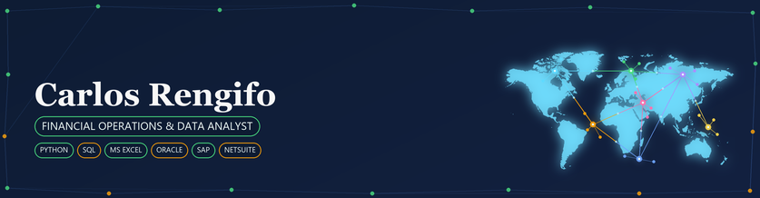

  

<h1 align="center">HI 👋, I'M CARLOS RENGIFO</h1>

  

  I use Python and SQL to analyze datasets and perform ETL/ELT processes. I build data pipelines with APIs to power Power BI dashboards and automate workflows that improve accuracy, enable live data feeds, and support data modeling.

  
  

<h3 align="left">MY EXPERIENCE</h3>

- **Accounts Receivable Analyst & Collections Specialist** — Banking company, Credit Cards and Recovery departments.
- **Accounts Receivable Analyst & Key Accounts Manager** — Healthcare company, Recovery and Risk department.
- **Accounts Payable & Receivables Analyst** — Logistics company, Issue Resolution Team supporting worldwide operations.

<h3 align="left">CURRENTLY BUILDING</h3>

- 🔭 Invoice Chaser system
- 🛡️ Invoicing Fraud Protection system
- 📊 Credit Risk Management and Alerting system
- 💰 Cash Application Controller system

<h3 align="left">WHAT I WORK WITH</h3>

Tools and techniques I use to turn financial operations into reliable, actionable data.

  
  
  
  
  
  
  
  
  
  
  
  
  
  
  
  

<h3 align="left">FOCUS AREAS</h3>

- Finance Operations Analyst
- Data Analyst
- Billing Analyst
- Business Analyst
- Accounts Payable & Receivables Analyst

<h3 align="left">LINKS</h3>

Personal brand links coming soon.

  
  
  
  

<h3 align="left">PROJECTS</h3>

- **Finance Data Pipeline** — API-driven ETL/ELT workflows designed to deliver operational data to Power BI.
- **Automated Finance Reporting** — Python and SQL workflows focused on improving accuracy and reducing manual work.

<h3 align="left">GITHUB ACTIVITY</h3>

  

  

  

